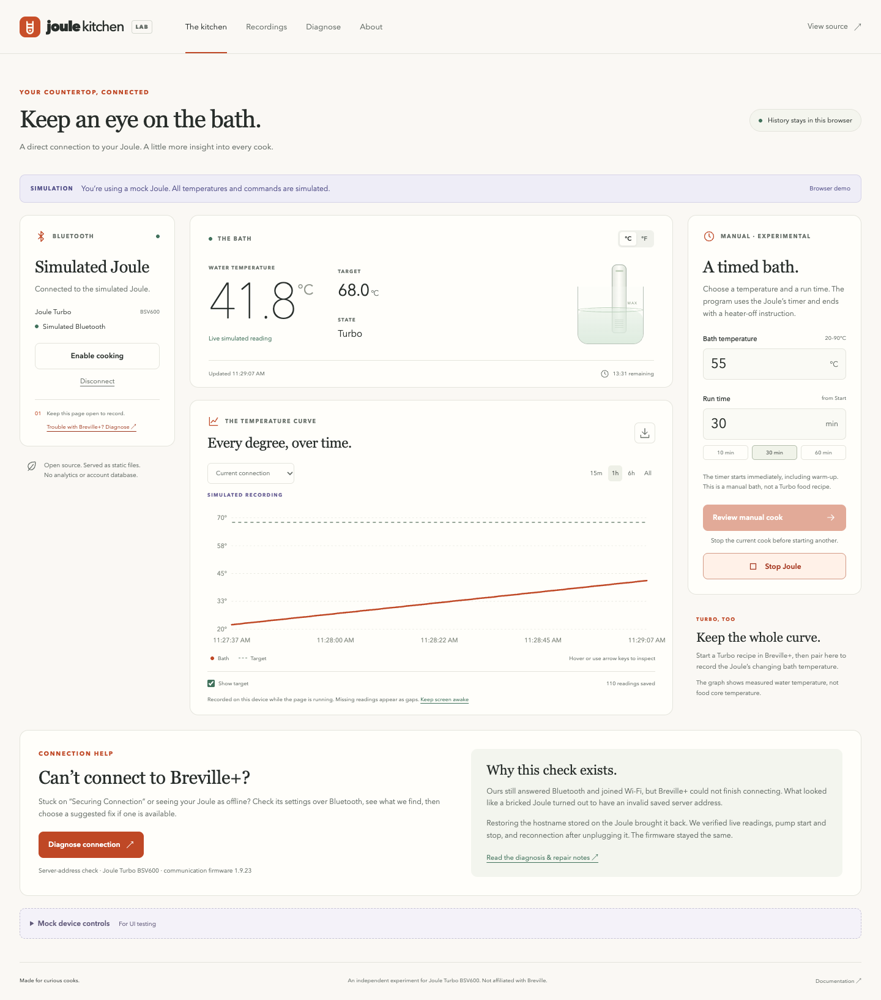
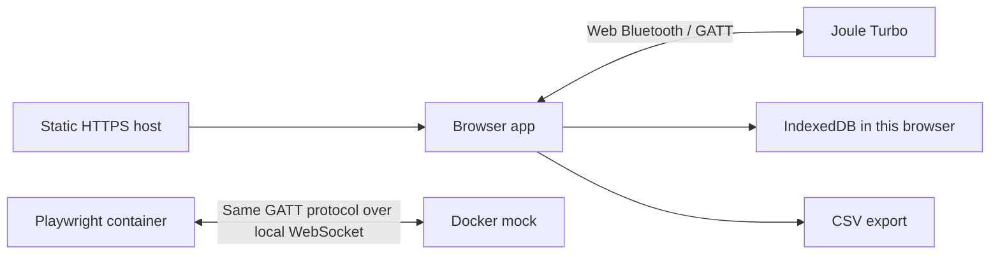

# Joule Kitchen

[](https://github.com/AndreKurait/joule-kitchen/actions/workflows/pages.yml)
[](https://github.com/AndreKurait/joule-kitchen/actions/workflows/docker.yml)

A static browser app for **Joule Turbo BSV600**. Pair over Bluetooth, watch the
bath, and keep temperature recordings in your browser. No account, application
server, telemetry service, or cloud database is required for Bluetooth.

**[Open Joule Kitchen](https://andrekurait.github.io/joule-kitchen/)** ·
[Protocol notes](docs/PROTOCOL.md) · [Testing](docs/TESTING.md)

> Early experimental release. Bluetooth monitoring and manual timed programs
> are separate from Breville's native Turbo recipe system. See the tested scope
> below before using cooking controls.



## What works

- Browser device chooser, service/serial identity validation, live status,
  heartbeat replies, physical-button confirmation, and reconnect.
- Actual measured bath temperature and target shown separately, °C/°F,
  interactive temperature graph, and visible gaps when readings stop.
- IndexedDB recordings that survive reload, complete CSV export, and deletion.
  Simulated recordings are labelled and kept in separate sessions.
- An experimental **manual timed bath** using the appliance's timer and an
  explicit heater-off instruction. Start requires a fresh idle state, physical
  button confirmation, and an on-screen review. Stop interrupts queued uploads;
  Start is never automatically retried.
- An in-browser demo and a **Docker mock device** that implement the GATT
  messages used by the real adapter. Browser tests send real serialized protocol
  frames to the simulated appliance; they don't fake the UI's status endpoint.
- GitHub Actions runs protocol, persistence, desktop and mobile UI tests before
  deploying the static `dist/` directory to GitHub Pages.

### Tested scope and current limits

| Capability                                                | Status                                                                                                   |
| --------------------------------------------------------- | -------------------------------------------------------------------------------------------------------- |
| Real BSV600 direct BLE status and temperature             | Verified using comm firmware 1.9.23 / task-engine 2.5.2                                                  |
| Native browser pairing and recording                      | Implemented; release validation is recorded in [TESTING.md](docs/TESTING.md)                             |
| Manual timed cook and Stop                                | Protocol implemented and tested against the mock; real-device status is in [TESTING.md](docs/TESTING.md) |
| Record an existing Turbo cook                             | Uses reported native mode and measured bath readings                                                     |
| Compile/start a native Turbo food recipe entirely offline | Not implemented; food/geometry coefficients and recipe compilation need separate validation              |
| Wi-Fi sign-in from a static browser app                   | Not available yet; see below                                                                             |
| First-time Wi-Fi provisioning, legacy Joule models        | Not implemented                                                                                          |
| Pump-only, heater-disabled circulation, 0–1°C cooking     | Not implemented; manual range is 20–90°C                                                                 |
| Background recording after the browser closes             | Not available; keep the page running                                                                     |
| Cross-device history synchronization                      | Not implemented; export CSV                                                                              |

The real protocol work used an already provisioned Joule. Account-free Bluetooth
monitoring does not prove first-time appliance onboarding works without the
vendor app. Manual cooking controls currently require the tested firmware pair;
Stop and monitoring remain available separately.

## Use the website

1. Open the HTTPS site in a browser with Web Bluetooth: Chrome/Edge on a
   supported computer or Chrome on Android. Safari, iOS Safari, and Firefox
   do not currently provide the required API.
2. Keep the Joule nearby. Select **Pair Joule** and choose it in the browser's
   device chooser. Close another app's Bluetooth connection if pairing fails.
3. Live status starts recording automatically. For manual controls, select
   **Enable cooking** and press the Joule's top button once.
4. Review the target and run time before starting. **Run time begins at Start,
   including warm-up**, rather than after reaching the target.
5. Keep the page open to record. Export CSV for a copy outside browser storage.

The graph measures **water**, not food core temperature or doneness.
The appliance owns a submitted program: closing the site does not stop it.
If Stop cannot be confirmed, check the Joule and unplug it if it is still running.

### Optional Wi-Fi access

Bluetooth does not ask for a login. The UI explains Wi-Fi's current limitation
and does not present a nonfunctional password form.

The investigated Breville control API rejects the cross-origin preflight
needed by this site. Its verified live WebSocket connection also requires
custom authorization headers unavailable to browser WebSockets. A legitimate
browser-compatible owner login and transport, or an authenticated companion
service, still needs to be implemented. This repository contains no emulator
session extraction, account token, relay credentials, or owner-specific device
identifier.

The account history responses inspected contained cook metadata and setpoints,
not a historical measured temperature series. This app therefore records
incoming readings itself. That is not a claim about every internal Breville API.

## Run locally

Use Node.js 24:

```sh
npm ci
npm run dev
```

Open `http://127.0.0.1:5173`. Localhost is a secure context for Web Bluetooth.

```sh
npm run build
npm run preview
```

The output is static HTML/CSS/JS in `dist/`. It uses relative asset paths and
works under a project path such as `/joule-kitchen/`. It can also be served by
another HTTPS static host. No server-side rendering or environment secret is
needed.

## Run the mock device in Docker

```sh
docker compose up --build
```

Open **`http://127.0.0.1:4173/?mock=server`** and select **Try a simulated Joule**.
Expand **Mock device controls** to press the simulated physical button, send
Turbo status, truncate a frame, pause readings, slow an upload, or drop the
connection. You can also simulate a missing temperature sensor to check that
Start stays disabled while Stop remains available. All simulation views and
CSVs are labelled.

```sh
npm run test:docker
npm run test:docker:down
```

The first command builds the static app, starts the mock, and runs Playwright
desktop/mobile UI tests in a second container. It exits with the tests' status.
The mock uses a project Docker bridge network and publishes **127.0.0.1 only**.
It has no Bluetooth adapter or cloud credentials and makes no requests to a
real Joule or Breville. Each WebSocket gets an independent simulated device.
The test image installs only Chromium, with its revision pinned by
`package-lock.json`. CI also checks the mock's published localhost address.

Without Docker:

```sh
npm run check
npx playwright install chromium
npm run test:ui
```

The Playwright configuration starts the local mock server automatically. Build
first (`npm run build`) after UI changes. The public site's **Try a simulated
Joule** runs the same simulation in memory without needing Docker.

## GitHub Pages and Actions

The workflow in [`.github/workflows/pages.yml`](.github/workflows/pages.yml)
tests every pull request and every push to `main`. Only a successful `main`
build can deploy. It runs the unit and UI suites against the protocol mock on
a GitHub container runner. The separate
[Docker workflow](.github/workflows/docker.yml) runs the same UI suite in
Docker and checks the published localhost port.

Deployment uses GitHub's short-lived Pages identity, minimal job permissions,
and pinned Action commits; no deployment secret is needed.

For a fork, enable **Settings → Pages → Build and deployment → GitHub Actions**
and run the workflow. Update the repository links in `src/App.tsx` and this
README if distributing under a different name. No personal data is bundled:
the public artifact is only `dist/`.



## Contributing

Run `npm run check` and `npm run test:docker` before proposing a change.
Do not add physical-device access to CI. Protocol tests must verify malformed
frames, command ordering, and source/units in recorded data, not just mirror
the implementation. Keep Start an explicit user action and avoid replaying it
after reconnect or a timeout.

Please don't commit accounts, device identities, recordings, captures, vendor
APKs/firmware, or decompiled source. This is an independent interoperability
project, not affiliated with Breville. The implementation and original artwork
in this repository are MIT licensed; third-party dependencies retain their
own licenses.
